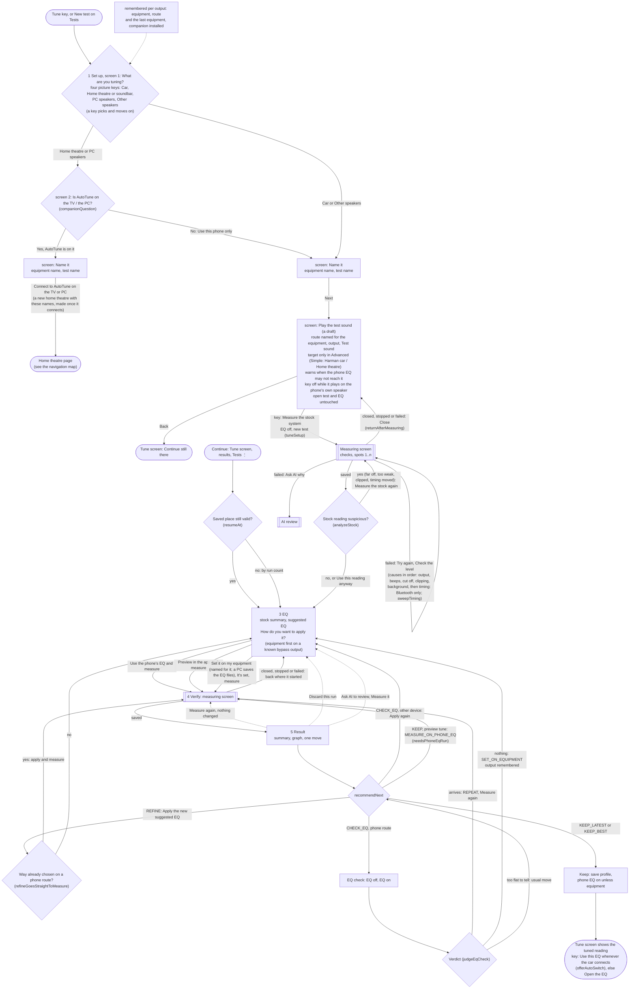
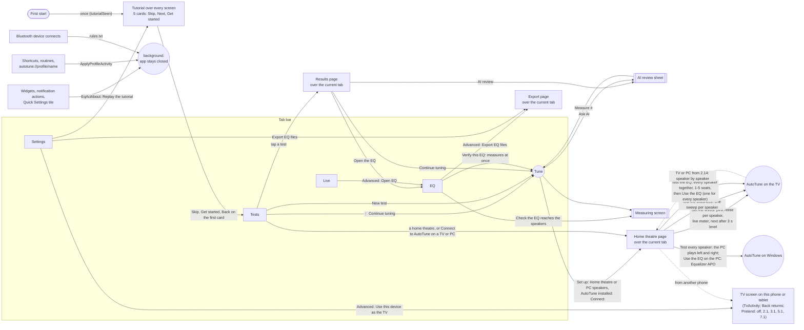

# AutoTune flow maps (2.24.0)

How a tuning session flows and how you move around the app, drawn from the code. Update this file whenever a Tune step, a pinned action or a link between screens changes (see CLAUDE.md). Code names in brackets point at where each decision lives.

## Process map: one tuning session

Every measurement starts the moment its key is pressed. Stock and Verify are measuring phases with no page: a closed, stopped or failed measurement returns to the step it started from. Tune is three screens (Set up, EQ, Result) plus the measuring screen. Back follows `previousStep`; Exit remembers the step for Continue.

## After every reading

| Screen | The one key | Other choices |
|---|---|---|
| Set up, one question per screen | What are you tuning: Next (a picture key also moves on); Is AutoTune on it: the answer given last time (Connect to AutoTune on the TV/PC, or Use this phone only); Name it: Next; Play the test sound: Measure the stock system | The other answer on the AutoTune screen; route, output, Test sound; Advanced: target, measurement options, tools |
| Measuring | See the result (closes itself when all checks pass), or Try again | Measure next spot, Check the level, Ask AI why, Close |
| EQ, after stock | Use the phone's EQ and measure; Measure the stock again when the stock looks wrong; It's set, measure on equipment | Preview in the app, Set it on my equipment; Advanced: target, sliders, bands, files, AI |
| Result | Apply the new suggested EQ, Keep this EQ and finish, Keep the EQ of run n, Check the EQ reaches the speakers, Measure again, Set it on my equipment, or Switch on the phone's EQ and measure | The other moves, Measure again, Ask AI, All results, Discard |
| Tune screen after Keep | Use this EQ whenever <device> connects (phone EQ, Bluetooth route), else Open the EQ | Tune (new test), Continue |
| Home theatre page | Connect; then nothing is pinned between tests: Set the levels, Test the distances and Test the EQ each sit in their own card; Next speaker / Measure seat n / Stop while a test runs | The big EQ on/off key (sends the last EQ or switches it off), Check the EQ reaches the speakers, Disconnect; after an EQ test a Refine card (the bands to set by hand, Share the EQ files; Advanced: target, bass and treble, kept per home theatre); the home theatre line opens Home theatres (pick, New, Rename, Delete); Advanced: EQ test seats. A TV or PC from 2.14: speaker by speaker |
| Test results page | Continue tuning, with the move it leads to on its second line ("next: …") | Open the EQ, AI review (at the bottom, above Details) |

## Navigation map

Back closes the newest page first, then returns a tab to Tests. Inside Tune, Back walks the steps instead.

Open improvements found while drawing these maps are in `BACKLOG.md` ("Flow review, 9 Nov 2026").
