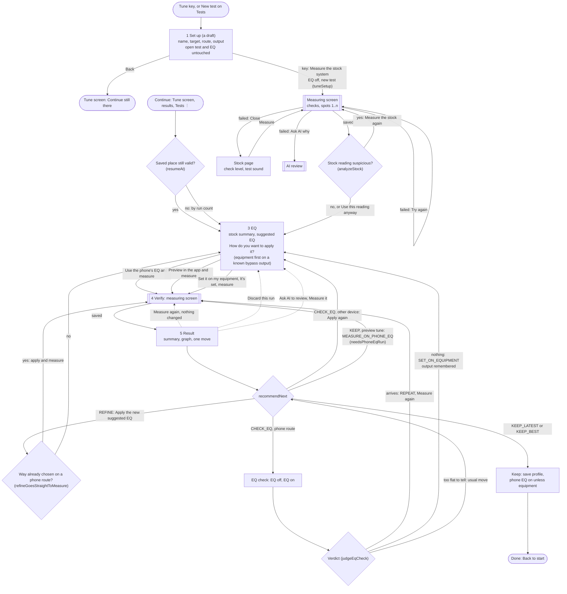
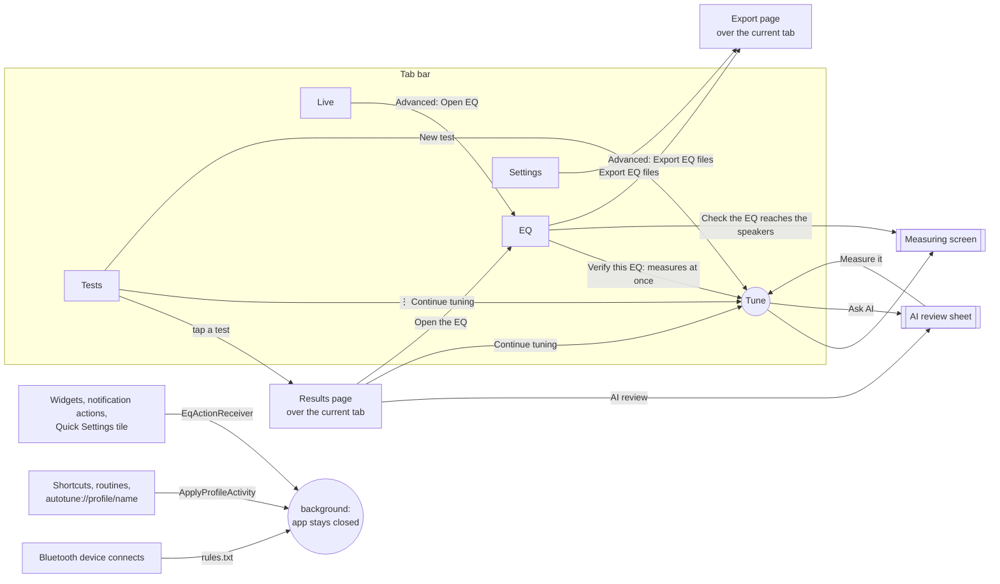

# AutoTune flow maps (2.5.0)

How a tuning session flows and how you move around the app, drawn from the code. Update this file whenever a Tune step, a pinned action or a link between screens changes (see CLAUDE.md). Code names in brackets point at where each decision lives.

## Process map: one tuning session

Every measurement starts the moment its key is pressed. The Stock and Verify pages are only where a failed or closed measurement lands. Back follows `previousStep`; Exit remembers the step for Continue.

## After every reading

| Screen | The one key | Other choices |
|---|---|---|
| Measuring | See the result (closes itself when all checks pass), or Try again | Measure next spot, Ask AI why, Close |
| EQ, after stock | Use the phone's EQ and measure; Measure the stock again when the stock looks wrong; It's set, measure on equipment | Preview in the app, Set it on my equipment; Advanced: target, sliders, bands, files, AI |
| Result | Apply the new suggested EQ, Keep this EQ and finish, Keep the EQ of run n, Check the EQ reaches the speakers, Measure again, Set it on my equipment, or Switch on the phone's EQ and measure | The other moves, Measure again, Ask AI, All results, Discard |
| Done | Back to start | Open the EQ, See all results |
| Test results page | Continue tuning | Open the EQ, AI review |

## Navigation map

Back closes the newest page first, then returns a tab to Tests. Inside Tune, Back walks the steps instead.

Open improvements found while drawing these maps are in `BACKLOG.md` ("Flow review, 9 Nov 2026").
